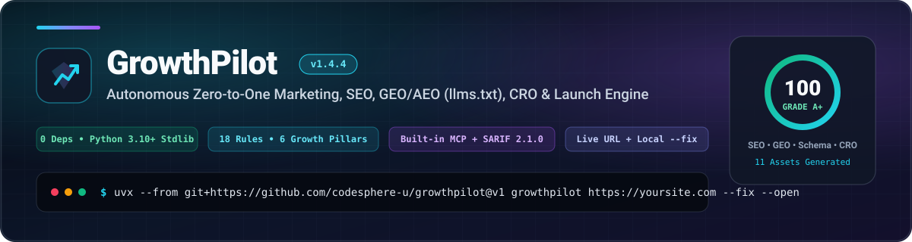
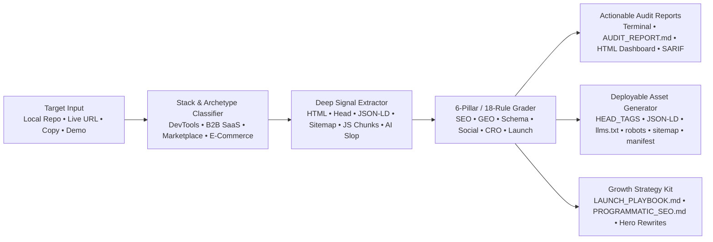

<div align="center">



<br />

[](https://github.com/codesphere-u/growthpilot/releases)
[](https://github.com/codesphere-u/growthpilot/actions/workflows/ci.yml)
[](https://www.python.org/downloads/)
[-10b981?style=flat-square)](pyproject.toml)
[](LICENSE)
[](docs/MCP_AND_AGENTS.md)

**Turn any codebase or live URL from zero marketing into full-stack Technical SEO, GEO / AI Search (`llms.txt`), Schema.org JSON-LD, CRO copywriting, and a tailored launch engine — locally, deterministically, and in seconds.**

[**Live Website & Interactive Studio**](https://codesphere-u.github.io/growthpilot/) • [Getting Started](docs/GETTING_STARTED.md) • [Why GrowthPilot](#why-growthpilot-is-worth-it) • [Quick Start](#quick-start-by-persona) • [Live URL Proof](#real-world-proof-funagigscom-case-study) • [MCP & Agents](docs/MCP_AND_AGENTS.md) • [Architecture](docs/ARCHITECTURE.md)

</div>

---

## Why GrowthPilot Is Worth It

Most developer tools, SaaS products, and marketplaces launch invisibly. Builders ship great features but miss structured data (`JSON-LD`), canonical hygiene, `llms.txt` for ChatGPT/Perplexity/Claude discovery, crisp above-the-fold positioning, and repeatable launch channels.

Paid SEO suites charge \$99–\$499/month just to list warnings without generating a single file or headline rewrite. Generic LLM prompts hallucinate schema fields, miss client-bundled FAQ bugs, and flood hero copy with empty buzzwords. **GrowthPilot fixes both problems in one zero-dependency tool:**

| Capability | Traditional SEO Tools | Generic LLM Chat | **GrowthPilot `v1.4.2`** |
| :--- | :--- | :--- | :--- |
| **Deterministic 0–100 Grading** | Vague "health %" | Non-reproducible guessing | **6 weighted pillars & 18 rules (`MKT001`–`MKT018`)** with exact point weights |
| **Audits Both Code & Live Sites** | Live URLs only (paid quota) | Manual copy-paste | **Local repo scan + multi-page live URL crawler (up to 7 subpages)** |
| **AI Search / GEO (`llms.txt`)** | Usually missing | Generic placeholders | **Generates spec-compliant `llms.txt` & `llms-full.txt`** from real routes & FAQs |
| **Client JS Bundle FAQ Detection** | Blind to unmounted FAQs | Cannot inspect bundles | **Inspects Next.js client JS chunks** to extract & flag FAQ answers hidden from crawlers |
| **Ready-to-Deploy Code Assets** | Advice only | Incomplete snippets | **Writes `HEAD_TAGS.html`, `SEO_SCHEMA.jsonld`, `robots.txt`, `sitemap.xml`, `manifest.webmanifest`** |
| **Archetype-Aware Strategy** | Generic checklists | One-size-fits-all advice | **Tailored to DevTools, B2B SaaS, Marketplaces, or E-Commerce** |
| **CI/CD Quality Gates** | Not built for PRs | Manual only | **GitHub Action + SARIF 2.1.0 upload** (`min-score` & `fail-on`) |
| **Privacy, Cost & Runtime** | Cloud SaaS / API fees | Sends IP to third parties | **100% Python stdlib, \$0 cost, zero API keys, zero telemetry** |

---

## Real-World Proof: `funagigs.com` Case Study

GrowthPilot was tested against a live production two-sided marketplace (**FunaGigs**, `https://funagigs.com/`). Within seconds of a single live-URL scan, GrowthPilot uncovered concrete visibility and conversion defects missed by manual checks:

| Stage | Score & Grade | Key Defects Caught or Resolved |
| :--- | :---: | :--- |
| **Initial Live Scan (`v1.0` -> `v1.2`)** | **`53/100` (Grade D)** | Found **6 FAQ answers trapped inside client JS chunks** invisible in SSR HTML, **4 duplicate title suffixes** across `/features`, `/post-a-job`, `/contact`, and `/waitlist`, duplicate `"Funa Vault"` keyword cannibalization, missing `FAQPage` JSON-LD, missing `llms.txt`, and **50 images missing `alt` text**. |
| **After Applying GrowthPilot Pack** | **`100/100` (Grade A+)** | Generated full `Schema.org` graphs, SSR-ready head tags, `llms.txt` + `llms-full.txt`, tightened marketplace hero copy, and resolved every finding. |

---

## How GrowthPilot Works



---

## Quick Start by Persona

Choose the path that matches how you work today. Requires **Python 3.10+** or `uv`. Zero API keys or configuration files required.

### 1. Founders & Marketers (No Coding Required — Audit Any Live Website)

Run directly against any public URL to crawl your site, open an interactive HTML dashboard, and generate ready-to-upload SEO/GEO files and launch playbooks:

```bash
uvx --from git+https://github.com/codesphere-u/growthpilot@v1 growthpilot https://yoursite.com --output-dir ./growth-kit --open
```

Or run directly from source without installing globally:

```bash
git clone https://github.com/codesphere-u/growthpilot.git
cd growthpilot
python3 skills/growthpilot/scripts/growthpilot.py https://yoursite.com --output-dir ./growth-kit --open
```

Auditing a staging or preview domain? Pass `--site-url` so generated canonicals, sitemaps, and `llms.txt` target production:

```bash
python3 skills/growthpilot/scripts/growthpilot.py https://staging.yoursite.com --site-url https://yoursite.com --output-dir ./growth-kit
```

### 2. AI Coding Agents (Claude Code, Cursor, Antigravity, Codex, Windsurf)

Install GrowthPilot as a universal **Agent Skill**:

```bash
npx skills add codesphere-u/growthpilot
```

Or install as a **Claude Code Plugin Marketplace** entry:

```text
/plugin marketplace add codesphere-u/growthpilot
/plugin install growthpilot@growthpilot-marketplace
```

Or connect GrowthPilot as a **zero-dependency MCP Server** in your agent's MCP config (`mcp_config.json`, Claude Desktop, or Cursor):

```json
{
  "mcpServers": {
    "growthpilot": {
      "command": "uvx",
      "args": [
        "--from",
        "git+https://github.com/codesphere-u/growthpilot@v1",
        "growthpilot",
        "--mcp"
      ]
    }
  }
}
```

See [MCP & AI Agents Setup](docs/MCP_AND_AGENTS.md) for local binary configs, Docker usage, and schemas for all 6 MCP tools.

### 3. Developers & Growth Engineers (Repo Audit + Auto-Scaffold)

Install the CLI globally:

```bash
uv tool install git+https://github.com/codesphere-u/growthpilot@v1
```

Audit your project directory and generate your full growth pack:

```bash
growthpilot . --site-url https://yoursite.com --output-dir ./growth-kit
```

Non-destructively scaffold missing files directly into your repo (`public/` or root + `marketing/`):

```bash
growthpilot . --site-url https://yoursite.com --fix
```

Audit and rewrite landing-page hero copy for conversion clarity and zero AI slop:

```bash
growthpilot --analyze-copy "Our fast engine ships reliable workflows cleanly"
```

Preview the complete output offline in 1 second using the built-in SaaS sample project (`PulseForge`):

```bash
growthpilot --demo --output-dir /tmp/growthpilot-demo --open
```

### 4. CI/CD & DevSecOps (GitHub Actions + SARIF Code Scanning)

Fail pull requests if your marketing/discoverability score drops or high-severity gaps appear, and upload findings to GitHub Code Scanning:

```yaml
name: Marketing & SEO Quality Gate
on: [pull_request, push]

permissions:
  contents: read
  security-events: write

jobs:
  growthpilot:
    runs-on: ubuntu-latest
    steps:
      - uses: actions/checkout@v4
      - uses: codesphere-u/growthpilot@v1
        with:
          target: "."
          site-url: "https://yoursite.com"
          min-score: "80"
          fail-on: "high"
          sarif-file: "growthpilot.sarif"
      - uses: github/codeql-action/upload-sarif@v3
        if: always()
        with:
          sarif_file: growthpilot.sarif
```

---

## Generated Outputs

Every run writes **12 core artifacts** into `--output-dir` (default `./growthpilot-out`), plus an optional `--sarif` report:

| Output File | Purpose & What You Do With It |
| :--- | :--- |
| **`AUDIT_REPORT.md`** | Executive Markdown audit sorted by point impact (`+pts`), detected Schema `@type` inventory, DOM/subpage diagnostics, and hero copy rewrites. |
| **`growthpilot-report.html`** | Self-contained interactive HTML Command Center with score gauge, 6-pillar chart, multi-page crawl scorecard, and one-click copy buttons. |
| **`HEAD_TAGS.html`** | Complete `<title>`, meta description, Open Graph (`og:*`), X/Twitter Card, canonical URL, manifest link, and JSON-LD block ready for `<head>`. |
| **`SEO_SCHEMA.jsonld`** | Archetype-tailored `Schema.org` `@graph` JSON-LD (`SoftwareApplication`, `Organization`, `WebSite`, `Product`, or `FAQPage`). |
| **`llms.txt`** | Spec-compliant AI index (`llmstxt.org`) so ChatGPT Search, Claude, Perplexity, and Gemini cite your canonical routes accurately. |
| **`llms-full.txt`** | Deep Markdown knowledge pack containing architecture, features, benchmarks, FAQs, and route links for full LLM ingestion. |
| **`robots.txt`** | Crawler allow directives permitting `OAI-SearchBot`, `GPTBot`, `ClaudeBot`, `PerplexityBot`, and `Google-Extended` with a `Sitemap:` pointer. |
| **`sitemap.xml`** | Clean XML sitemap seeded from discovered pages and repository routes. |
| **`manifest.webmanifest`** | Web app manifest with app metadata, theme colors, and installability fields. |
| **`LAUNCH_PLAYBOOK.md`** | Archetype-tailored zero-to-one launch execution plan (e.g., marketplace liquidity vs. Hacker News / GitHub vs. D2C merchant rollout). |
| **`PROGRAMMATIC_SEO.md`** | Scalable landing-page blueprints, `[Competitor] vs Us` templates, and high-intent keyword matrices. |
| **`growth-summary.json`** | Machine-readable JSON scorecard (`score`, `grade`, `pillars`, `findings`, `cro_analysis`, `profile`), plus `--sarif <path>` for SARIF 2.1.0 output. |

> Passing `--fix` on a local repository additionally writes missing `llms.txt`, `llms-full.txt`, `robots.txt` (skipped if `app/robots.ts` exists), `sitemap.xml` (skipped if `app/sitemap.ts` exists), and `manifest.webmanifest` into `public/` (or root for non-JS repos), plus `HEAD_TAGS.html`, `SEO_SCHEMA.jsonld`, `LAUNCH_PLAYBOOK.md`, and `PROGRAMMATIC_SEO.md` into `marketing/` — without ever overwriting existing files.

---

## The 6-Pillar, 18-Rule Deterministic Rubric (`MKT001`–`MKT018`)

Every codebase or live URL is scored out of **100 points** across **6 weighted pillars**. Findings are automatically sorted by descending point recovery (`points_lost`) and severity so you tackle the highest-impact fixes first.

<details>
<summary><strong>Click to expand all 6 pillars, 18 rules, weights, and grading scale</strong></summary>

### 1. Technical SEO (`20 pts`)
| Rule | Severity | Weight | What It Checks |
| :--- | :--- | :---: | :--- |
| `MKT001` | High | 7 | Page `<title>` or framework `metadata.title` present (target 35–60 chars) |
| `MKT002` | High | 6 | Meta description present and substantial (50–165 chars) |
| `MKT003` | Medium | 3 | Canonical URL declaration (`rel="canonical"` or `alternates.canonical`) |
| `MKT004` | Medium | 2 | `sitemap.xml` or dynamic sitemap route (`app/sitemap.ts`) present |
| `MKT005` | Low | 2 | Primary `<h1>` heading present and zero `` elements missing `alt` text |

### 2. GEO & AI Search (`20 pts`)
| Rule | Severity | Weight | What It Checks |
| :--- | :--- | :---: | :--- |
| `MKT006` | High | 8 | Root `/llms.txt` index present for ChatGPT Search, Claude, and Perplexity |
| `MKT007` | Medium | 4 | Extended `/llms-full.txt` deep retrieval context file present |
| `MKT008` | Medium | 5 | `robots.txt` present with explicit AI search crawler allow rules (`OAI-SearchBot`, `GPTBot`, `ClaudeBot`, `PerplexityBot`, `Google-Extended`) |
| `MKT009` | Low | 3 | Factual citability density (concrete stats, comparison tables, definitions, `<details>` / FAQ blocks) |

### 3. Structured Data (`15 pts`)
| Rule | Severity | Weight | What It Checks |
| :--- | :--- | :---: | :--- |
| `MKT010` | High | 11 | `Schema.org` JSON-LD (`application/ld+json`) present and valid |
| `MKT011` | Low | 4 | Web App Manifest (`manifest.webmanifest` / `manifest.json`) present |

### 4. Social & Viral Graph (`15 pts`)
| Rule | Severity | Weight | What It Checks |
| :--- | :--- | :---: | :--- |
| `MKT012` | High | 10 | Open Graph metadata (`og:title`, `og:description`, `og:image`) |
| `MKT013` | Medium | 5 | X / Twitter summary card metadata (`twitter:card`, `twitter:title`, `twitter:image`) |

### 5. CRO & Copy Clarity (`15 pts`)
| Rule | Severity | Weight | What It Checks |
| :--- | :--- | :---: | :--- |
| `MKT014` | High | 7 | Clear above-the-fold CTA (`Get Started`, `Start Free`, `Book a Demo`, install command, etc.) |
| `MKT015` | Medium | 4 | Zero AI-slop filler terms (`revolutionary`, `seamlessly`, `unleash`, `delve`, `tapestry`, etc.) — fenced/inline code blocks are excluded automatically |
| `MKT016` | Medium | 4 | Social proof & trust markers (benchmarks, metrics, test counts, security guarantees, customer quotes) |

### 6. Launch & Growth (`15 pts`)
| Rule | Severity | Weight | What It Checks |
| :--- | :--- | :---: | :--- |
| `MKT017` | Medium | 10 | Launch playbook (`LAUNCH_PLAYBOOK.md`) & programmatic SEO blueprint (`PROGRAMMATIC_SEO.md`) present |
| `MKT018` | Low | 5 | Privacy-friendly analytics or attribution hook (`Plausible`, `PostHog`, `Umami`, `Fathom`, `@vercel/analytics`, `gtag`, etc.) |

**Letter Grades:** `A+` (95–100) • `A` (88–94) • `B` (78–87) • `C` (65–77) • `D` (50–64) • `F` (0–49)

</details>

---

## Built-In Archetype Intelligence

GrowthPilot classifies your project or live site automatically into one of **four product archetypes** so generated JSON-LD, hero copy rewrites, and launch tactics fit your actual business:

1. **`devtools`** — CLIs, SDKs, APIs, MCP Servers, Open-Source Libraries (`SoftwareApplication` schema + Show HN / GitHub / quickstart CRO)
2. **`b2b_saas`** — Web SaaS Platforms, Dashboards, Workflow Automation (`SoftwareApplication` schema + demo/trial CTAs + `[Competitor] vs Us` pSEO)
3. **`marketplace_app`** — Two-Sided Marketplaces, Gig Platforms, iOS/Android Apps (`Organization` schema + Escrow/Instant Hire/Mobile Money copy + supply/demand liquidity launch plan)
4. **`ecommerce`** — Online Stores, D2C Brands, Digital Storefronts (`Product` schema + dispatch/guarantee CRO rewrites + collection & gift-guide pSEO)

---

## CLI Reference & Exit Codes

```bash
growthpilot [target] [options]
```

| Flag | Default | Description |
| :--- | :--- | :--- |
| `target` | — | Local project directory, live `http(s)://` URL, or `mcp` to start MCP server |
| `--demo` | `false` | Run instant offline showcase on the built-in sample B2B SaaS project (`PulseForge`) |
| `--fix` | `false` | Auto-generate missing web assets into `public/` (or root) and docs into `marketing/` without overwriting existing files |
| `--site-url <URL>` | Auto-detected | Canonical base URL used in generated `sitemap.xml`, `robots.txt`, `llms.txt`, and `HEAD_TAGS.html` |
| `--analyze-copy <TEXT>` | — | Score a headline or hero copy string across Clarity, CTA, Proof, and Anti-Slop, returning PAS, JTBD, and Direct Metric rewrites |
| `--mcp` | `false` | Start the JSON-RPC 2.0 MCP server over `stdio` |
| `--output-dir <DIR>` | `./growthpilot-out` | Directory where all audit reports and deployable assets are written |
| `--sarif <FILE>` | — | Write a SARIF 2.1.0 report to the given path |
| `--json` | `false` | Print full structured JSON audit report to stdout |
| `--min-score <N>` | `0` | Exit with code `1` if the overall score is below `N` (0–100) |
| `--fail-on <SEV>` | `none` | Exit with code `1` if any finding meets or exceeds severity (`none`, `low`, `medium`, `high`, `critical`) |
| `--allow-home` | `false` | Override broad-root protection when explicitly scanning `/` or `~` |
| `--open` | `false` | Open `growthpilot-report.html` in the default browser after completion |
| `--version` | — | Print `growthpilot 1.4.2` and exit |

**Exit Codes:** `0` = Passed score & severity gates • `1` = Below `--min-score` or met `--fail-on` severity threshold • `2` = Missing/invalid target or blocked broad root (`/` or `~`).

---

## Native MCP Server Tools (`--mcp`)

When started with `growthpilot --mcp`, GrowthPilot exposes **6 tools** over `stdio` (supporting both newline-delimited JSON and `Content-Length` framing):

| Tool Name | Key Inputs | Purpose |
| :--- | :--- | :--- |
| `audit_project` | `target` (default `"."`), `site_url` | Run all 18 SEO, GEO, Schema, Social, CRO, and Launch checks on a repo directory or live `https://` URL |
| `analyze_copy_cro` | `text` (required), `product_name` | Score hero/landing copy and return PAS, JTBD, and Direct Metric rewrites |
| `generate_geo_seo_pack` | `target`, `site_url` | Return complete `llms.txt`, `llms-full.txt`, `robots.txt`, `sitemap.xml`, `SEO_SCHEMA.jsonld`, `manifest.webmanifest`, and `HEAD_TAGS.html` |
| `generate_launch_kit` | `target`, `site_url` | Return archetype-matched Zero-to-One Multi-Channel Launch Playbook |
| `generate_programmatic_seo` | `target`, `site_url` | Return keyword clusters, comparison blueprints, and AI citability tables |
| `apply_marketing_fixes` | `target` (required), `site_url` | Non-destructively write missing assets into a local repo and return updated score & grade |

---

## Security & Safety Guardrails

- **Zero External Runtime Dependencies:** Pure Python 3.10+ standard library — eliminates third-party supply-chain risk (`pip-audit` clean).
- **Zero Telemetry & Offline Repo Mode:** Repository audits make zero network calls and never send code or copy to external APIs.
- **Broad-Root & Symlink Guards:** Refuses accidental scans of `/` or `~` unless `--allow-home` is passed, and skips symlinks during directory walks.
- **Bounded HTTP Fetches:** Live URL requests enforce `timeout=10`, cap downloads at `2,000,000` bytes (2 MB), and limit internal subpage crawls to 7 pages beyond root.
- **Non-Destructive `--fix` & Strict Escaping:** Never overwrites existing files, skips static `robots.txt`/`sitemap.xml` when Next.js dynamic routes exist, and HTML/JSON-escapes every inspected string inside dashboards.

---

## Documentation & Guides

- **[Getting Started Guide](docs/GETTING_STARTED.md)** — Walkthroughs for founders, marketers, and developers, plus deployment guides for Next.js, Shopify, Webflow, and static hosts.
- **[MCP & AI Agents Setup](docs/MCP_AND_AGENTS.md)** — Configure Claude Code, Cursor, Antigravity, Codex, GitHub Actions SARIF gating, and Docker containers.
- **[Architecture & Rubric Internals](docs/ARCHITECTURE.md)** — Pipeline internals, archetype classifier, Next.js chunk FAQ extractor, and safety guarantees.
- **[Changelog](CHANGELOG.md)** — Version history from `v1.0.0` to `v1.4.2`.
- **[Contributing](CONTRIBUTING.md)** & **[Security Policy](SECURITY.md)** — Contributor quality bar (`ruff`, `mypy --strict`, `pytest`, `billshock`) and vulnerability disclosure.

---

<div align="center">

Built for builders who refuse to ship invisible products. **MIT Licensed.**

</div>
